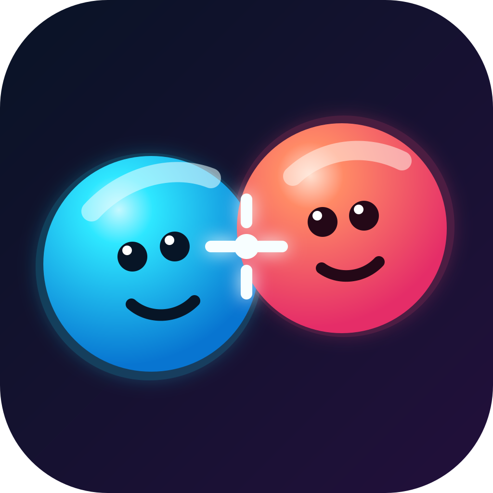
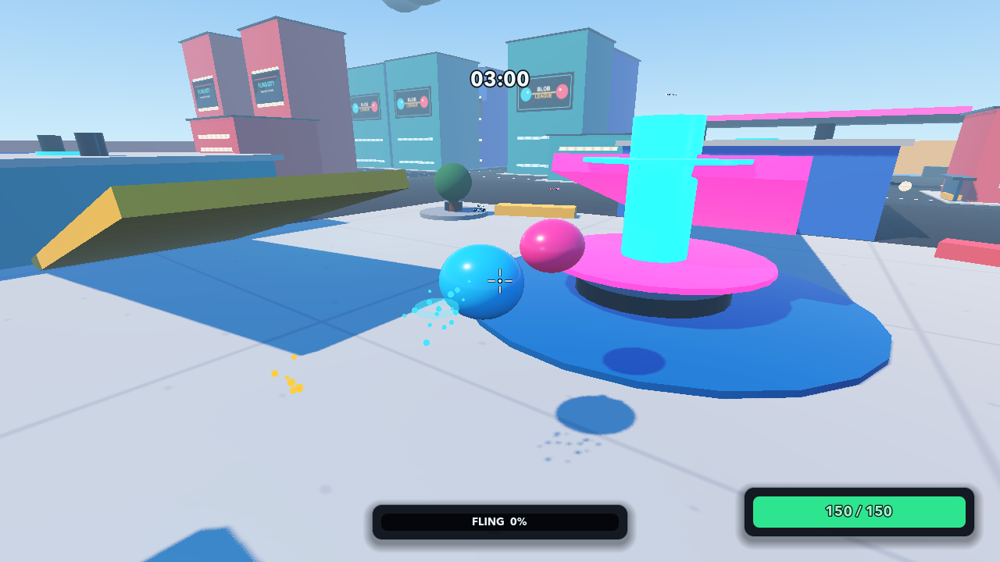

<div align="center">
  

  # Blob Duels

  **Bounce. Fling. Ricochet. Outplay your rival.**

  [](https://github.com/vg07013/blob-duels/releases/latest/download/Blob-Duels-macOS.zip)
  [](https://vg07013.github.io/blob-duels/)
</div>

Blob Duels is a physics-first 1v1 arena game where movement is a weapon. Charge a fling, bank shots off the scenery, chain abilities, and turn the arena itself against your opponent.



## What is in the arena?

- Fast local-feeling online duels and an offline practice mode.
- Five arenas with boost pads, bumpers, laser gates, wind zones, moving platforms, and dangerous drops.
- A movement-and-aim combat system built around momentum, ricochets, and creative angles.
- Abilities including Blink, Dash, Rail Shot, Gravity Pulse, and Bounce Mine.
- Unlockable blob colors, faces, trails, and effects.

## Download and play

[**Download the latest macOS build →**](https://github.com/vg07013/blob-duels/releases/latest/download/Blob-Duels-macOS.zip)

The current public alpha is a Universal macOS build for Apple Silicon and Intel Macs. This early build is ad-hoc signed but not Developer ID signed or notarized: after unzipping it, right-click `Blob Duels.app`, choose **Open**, and confirm the first launch. In the game, choose **Practice Offline**, **Host Game**, or **Join Game**.

Every release ships a `SHA256SUMS.txt`. To verify the archive before opening it, download both and run:

```bash
shasum -a 256 -c SHA256SUMS.txt
```

### Controls

| Action | Control |
| --- | --- |
| Move | `W` `A` `S` `D` |
| Brake | Hold `Left Shift` |
| Aim / shoot | Mouse / left click |
| Charge fling | Right click |
| Bounce | Space |
| Use ability | `E` |
| Toggle camera | Tab |

Direct online matches are an unauthenticated, trusted-friends-only alpha feature and use UDP port `7359`. Do not share your public IP broadly. A host playing outside their local network may need to allow the game through their firewall or forward that port, which exposes the game service to the internet until the rule is removed.

## Development

Blob Duels is built with Godot 4.7. Open `project.godot` in Godot and run the main scene to work on the game locally. The landing page lives in `website/` and is deployed to GitHub Pages on every push to `main`.

Gameplay, UI, and arena behaviour are covered by headless contract tests in `tests/`. Each one is a `SceneTree` script that exits non-zero on failure. Run the whole suite:

```bash
./scripts/run_tests.sh
```

Filter to one area while iterating, or stop at the first failure:

```bash
./scripts/run_tests.sh shop --fail-fast
```

The runner looks for Godot on `PATH` and in `/Applications`; set `GODOT` to override. It skips the `*_visual_capture.gd` scripts, which need a real rendering device and write reference PNGs rather than asserting. Run those by hand when you want fresh screenshots. CI runs the same suite on every push and pull request that touches game code.

The landing page has its own test:

```bash
node --test website/tests/landing-page.test.mjs
```

The game is still in active development, so balance, maps, networking, and presentation may change between alpha builds.

## Credits

Environment assets include CC0 packs by [Kenney](https://kenney.nl/). Individual asset licenses are included beside their source files.
